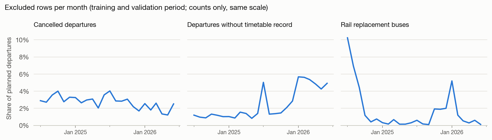
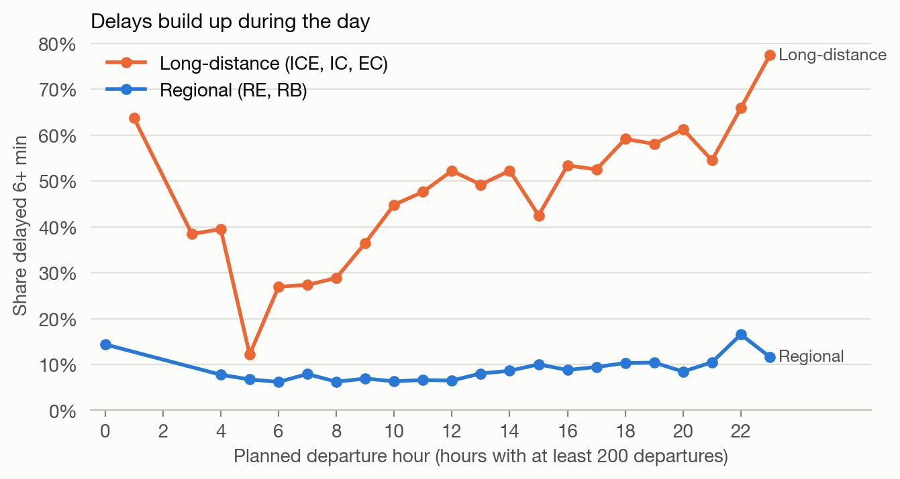
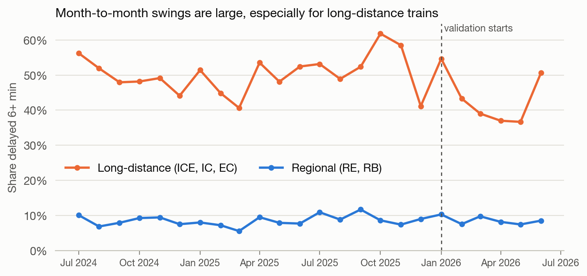
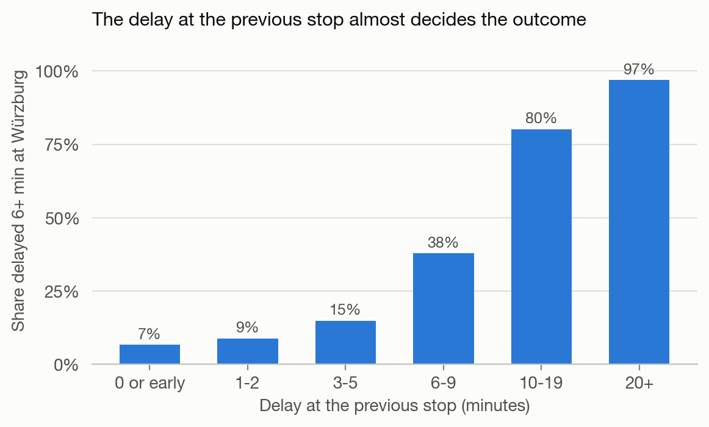

# Report section 3: Data (draft)

> Draft of 11 Nov 2026 for section 3 of the final report (planned length 3–4 pages, `docs/project_plan.md` section 7). The text between the two lines is the section; it has about 2,000 words of text, five tables and four figures. Decisions D1–D25 are proposals until the group confirms them; if a decision changes, the matching paragraph changes with it. Every number is traced to a file in "Where the numbers come from" at the end. **No delay rate of the test period appears in this section** (evaluation protocol, D13); the cells are marked and can be filled after the final run. Citations are written as [Author year] and are replaced by the template's citation style.

---

## 3 Data

### 3.1 Source and licence

We use the Deutsche Bahn Data archive [piebro 2024], an open collection of stop events published on Hugging Face under the CC BY 4.0 licence. The maintainer queries Deutsche Bahn's public Timetables API four times a day (03, 09, 15 and 21 UTC). Each run stores the planned timetable and the changes reported for the previous six or more hours. The archive provides one Parquet file per month. Each row is one stop of one train at one station, with the planned and the last reported arrival and departure times, the train type, line and train number, the final destination, cancellation flags and the position of the stop in the route (23 columns).

The archive starts in July 2024. Until 1 November 2025 it covers about 100 large stations (107–108 in the files we checked); from 2 November 2025 it covers all stations (about 5,300), and a monthly file then holds about 15 million rows. We use the 28 months from July 2024 to October 2026. Because the maintainer has reprocessed past months several times, the download is fixed to one dataset revision, and an automated test compares the local row counts with the counts recorded at download time.

The data contains no personal information. All timestamps are German local time.

### 3.2 From the archive to the departures at Würzburg Hbf

The raw files have about 5 GB. A DuckDB query reads each monthly file once and keeps two kinds of rows: the stops at Würzburg Hbf, and the earlier stops of the same trains (same ride identifier, lower stop position, planned at most 12 hours before the arrival at Würzburg). The earlier stops are needed for the en-route scenario. The result has 88 MB.

Würzburg Hbf has 365,502 stop events in the 28 months, about 390–470 per day (monthly medians). About a third of them are trains that end at Würzburg and have no departure. The unit of analysis is the **planned departure**: 247,716 rows.

### 3.3 Data checks

We checked the data before any modelling, because three properties of the archive decide what can be predicted and from when.

**Completeness.** No month is missing. The realised departure time is never empty. Only two days have fewer than 70% of the usual number of planned departures for their weekday; both are kept. No stop identifier occurs twice among the Würzburg rows.

**What the target measures.** The realised time is the last departure time the API reported, normally the actual time, but not an independent measurement. The maintainer documents collection gaps between November 2025 and July 2026. A gap would not show as missing rows but as departures whose reported time equals the planned time. We therefore searched for days with an unusually high share of exactly-on-time departures. The 11 days found are all holidays or Sundays with light traffic, and July 2026, the month with the longest documented gap (102 hours), has a normal share of exactly-on-time departures. No day is excluded. Gaps of a few hours cannot be ruled out at day level (section 6).

One recording change is visible: until November 2025, 1.2–2.5% of the departures per month are recorded as early; from December 2025 it is at most 0.15%. In the same period the share of departures with exactly 0 minutes of delay rises from about 34% to 42–46%. Early departures now appear as on time. The binary target is not affected, because both count as not delayed.

**Earlier stops are complete only from November 2025.** The en-route scenario needs the stop directly before Würzburg. Table 1 shows how often it is in the data for trains that arrive at Würzburg and depart again.

**Table 1.** Share of through trains whose directly preceding stop is in the data.

| Train type | Jul 2024 | Mar 2025 | Oct 2025 | Nov 2025 | Oct 2026 |
| --- | --- | --- | --- | --- | --- |
| Stations in the monthly file | 108 | 107 | 107 | 5,295 | 5,245 |
| ICE | 99.9% | 98.1% | 99.4% | 99.8% | 99.9% |
| RE | 0.0% | 0.0% | 0.0% | 93.5% | 100.0% |
| RB | 0.0% | 0.0% | 0.0% | 93.1% | 100.0% |
| Night trains (NJ) | 98.3% | 96.7% | 99.2% | 97.4% | 95.9% |

Long-distance trains stop almost only at large stations, so their previous stop was always in the archive. Regional trains stop at small stations that were added on 2 November 2025; per day, their coverage is 0% until 1 November, 2.6% on 2 November and 100% from 3 November 2025. Before that date the only earlier stop of a regional train in the data is a distant large station, where the delay says little about the delay at Würzburg. The en-route scenario is therefore trained only on data from 3 November 2025 (section 4).

**Category labels change over time.** In December 2025 two labels change. Line numbers get a prefix ("53" becomes "RB53"), and the trains of the operator Arverio, which ran as RE or RB before, get the train type ARV (lines RE 8, RB 8 and RE 80). The operator did not change, only the label. ARV is 0.2% of the departures in the training period (330 of 152,384) and 13.2% in the test period, so a model that used the raw train type would meet an almost unseen category. We therefore build two stable columns. `line_id` is the line with its prefix, built from the format of the value and not from the date; it gives 13 regional lines with the same names over the whole period. `service` groups the train types into regional (RE, RB, ARV), long-distance (ICE, IC, EC), night (NJ, EN) and other. The raw train type is used for reporting only.

### 3.4 Cleaning

The target is `delayed = 1` if the last reported departure time is 6 or more minutes after the planned time, else 0. Six minutes is the threshold of Deutsche Bahn's punctuality statistic [DB 2026], which is defined on arrivals; we apply it to departures.

The cleaning step deletes nothing. Every planned departure is kept and gets a reason if the models must not use it (Table 2). This keeps the counts transparent and lets the two sensitivity checks in section 5 select their rows by reason.

**Table 2.** Planned departures per period and exclusion reason. Periods are those of the main split (section 3.6). One further row without a timetable record is planned outside the 28 months.

| | Training | Validation | Test | Total |
| --- | --- | --- | --- | --- |
| Planned departures | 162,742 | 50,209 | 34,764 | 247,716 |
| Without timetable record | 2,524 (1.6%) | 2,561 (5.1%) | 2,204 (6.3%) | 7,290 |
| Cancelled | 4,854 (3.0%) | 1,009 (2.0%) | 568 (1.6%) | 6,431 |
| Rail replacement bus | 2,943 (1.8%) | 640 (1.3%) | 24 (0.1%) | 3,607 |
| Night of a clock change (00–05 h) | 35 | 5 | 11 | 51 |
| Invalid delay (below −30 min) | 2 | 1 | 1 | 4 |
| Duplicate identifier | 0 | 0 | 0 | 0 |
| **Modelling rows** | **152,384 (93.6%)** | **45,993 (91.6%)** | **31,956 (91.9%)** | **230,333** |

- **Cancelled departures** are excluded because the delay of a train that does not run is undefined; Deutsche Bahn's statistic also counts only trains that run. A passenger experiences a cancellation as the worst delay, so section 5 repeats the evaluation with cancellations counted as delayed.
- **Departures without a timetable record** exist in the data only because the change feed reported something for them. They are delayed about twice as often as the other departures (training period 52.9%, validation period 45.4%), and their share grows from 1.6% to 6.3%. Using them would select rows on the outcome, so they stay excluded; section 5 reports how the results change when they are included.
- **Rail replacement buses** are not trains. They are concentrated in construction periods (10% of the planned departures in July 2024, falling to 4% by September 2024; 5% in January 2026; otherwise at most 2%; Figure 1).
- **Clock changes.** Times are local time without a time zone, so a difference of two times can be wrong by 60 minutes in the night of a clock change. Departures planned between 00:00 and 05:00 on the five such days are excluded.
- **Invalid delays.** Four departures have a reported time 54 minutes to one day before the planned time (a wrong hour or date in the source).

**Figure 1.** Excluded departures per month as a share of the planned departures: cancelled, without timetable record, replacement bus (`reports/figures/eda_excluded_rows_by_month.png`).

### 3.5 Additional data

**Weather.** Hourly temperature, precipitation, wind speed, wind gusts, snowfall and snow depth at the station's location come from the Open-Meteo historical weather archive [Open-Meteo 2026] (CC BY 4.0): 20,470 hours without a missing value. We download the values in UTC and convert them to local time ourselves, because the archive's local-time option applies a fixed offset of one hour all year and would be one hour off in summer. The weather is observed weather; in the day-ahead scenario it stands in for a forecast (section 6).

**Calendar.** The 853 days of the period contain 28 public holidays in Bavaria (`holidays` package, including 15 August, which Würzburg observes), 226 school holiday days from the official announcement [BayMBl. 2022] and 10 bridge days (a working day between a public holiday and a weekend).

Both tables are joined to the departures on the planned local hour and on the date. Every modelling row gets a weather and a calendar value.

### 3.6 Final data sets

The split is chronological (Table 3; reasons in section 4). The delay rate of the test period is not computed before the single final evaluation.

**Table 3.** Modelling rows and share delayed per period.

| Data set | Training | Validation | Test |
| --- | --- | --- | --- |
| Scenario A: all departures | Jul 2024 – Dec 2025 | Jan – Jun 2026 | Jul – Oct 2026 |
| Rows | 152,384 | 45,993 | 31,956 |
| Delayed | 25.7% | 22.0% | [after the final run] |
| Scenario B: through trains with an earlier stop | 3 Nov 2025 – Apr 2026 | May – Jun 2026 | Jul – Oct 2026 |
| Rows | 23,926 | 8,020 | 15,898 |
| Delayed | 36.4% | 35.0% | [after the final run] |

47% of the departures start at Würzburg and have no earlier stop; they are part of scenario A only. Of the through trains in the scenario B periods, 172 have no usable earlier stop in the data (54, 30 and 88 per period) and are left out of scenario B.

The feature tables built from these rows (21 features for scenario A, 25 for scenario B) are described in section 4. Missing values have a structural reason in every case: the planned stop time is missing for the 47% of trains that start at Würzburg, the line for the 39% of departures that are not regional trains, and the 28-day history rates for 0.2–2.1% of the rows at the start of the period.

### 3.7 Exploratory analysis

All figures in this part use the training and validation periods only (July 2024 – June 2026, 198,377 departures).

**Delays are skewed.** 38.5% of the departures leave exactly on time, 35.4% are 1–5 minutes late, 12.0% are 6–15 minutes late, 10.7% are 16–59 minutes late and 2.1% are an hour or more late. The median delay is 1 minute, the mean 7.1 minutes. A regression on minutes would be dominated by the rare long delays; this supports the binary target, for which 24.8% of the departures are positive.

**The service dominates** (Table 4). Regional trains are delayed 8.5% of the time, long-distance trains 48.8% and night trains 66.6%. Among regional lines the rate runs from 3.4% (RE 20) to 19.0% (RB 8). The overall rate is thus a mix of two very different groups, and a model can look good overall by only separating them. We therefore report all results per service as well.

**Table 4.** Modelling rows and share delayed per service.

| Service | Training rows | Delayed | Validation rows | Delayed | Test rows |
| --- | --- | --- | --- | --- | --- |
| Regional | 91,376 | 8.5% | 29,345 | 8.6% | 20,751 |
| Long-distance | 56,607 | 50.2% | 15,248 | 43.7% | 10,410 |
| Night | 4,322 | 66.2% | 1,384 | 67.7% | 766 |
| Other | 79 | 36.7% | 16 | 50.0% | 29 |

**Time of day matters, and differently per service** (Figure 2). The delay rate of long-distance trains rises from about 27% at 6–8 h to 55–65% in the evening; regional trains stay between 6% and 10% for most of the day. Weekdays differ little (21.5% on Sundays to 27.7% on Thursdays). Months swing strongly without a simple seasonal pattern: long-distance trains between 37% and 62%, regional trains between 5.5% and 11.7% (Figure 3).

**Figure 2.** Share of delayed departures by planned hour and service (`reports/figures/eda_delay_by_hour.png`).

**Figure 3.** Share of delayed departures by month and service (`reports/figures/eda_delay_by_month.png`).

**Passing through is not the cause.** Through trains are delayed four times as often as trains that start at Würzburg (36% against 9%), but almost all long-distance trains pass through. Inside regional trains the difference disappears: 7.4% for through trains against 8.9% for trains that start here.

**The previous stop is informative, but not near the threshold** (Table 5, Figure 4). For the 31,946 scenario B departures of the training and validation periods, the delay at the previous stop and the departure delay at Würzburg correlate with 0.915. A train that was 6–9 minutes late at its previous stop still leaves Würzburg on time in 62% of the cases, because it makes up time on the way or during its stop. This is the range in which the simple rule "late at the previous stop means late at Würzburg" fails and a model can add something (section 5). The previous stop lies 16 planned minutes before the Würzburg departure for regional trains (median), 54 minutes for long-distance trains and 78 minutes for night trains.

**Table 5.** Share delayed at Würzburg by the delay at the previous stop (scenario B, training and validation periods).

| Delay at the previous stop | On time or early | 1–2 min | 3–5 min | 6–9 min | 10–19 min | 20 min or more |
| --- | --- | --- | --- | --- | --- | --- |
| Departures | 8,135 | 6,916 | 4,343 | 3,028 | 4,000 | 5,524 |
| Delayed at Würzburg | 6.7% | 8.8% | 14.9% | 37.8% | 80.1% | 96.9% |

**Figure 4.** Share delayed at Würzburg by the delay at the previous stop (`reports/figures/eda_propagation_previous_stop.png`).

---

## Where the numbers come from

| Numbers | File | Written by |
| --- | --- | --- |
| 28 months, 365,502 Würzburg rows, rows per day | `reports/checks/monthly_summary.csv` | `src/01_download.py` |
| Stations per file, Table 1 | `reports/checks/coverage_by_month.csv`, `coverage_nov_2025_daily.csv` | `checks/coverage_check.py`, `checks/data_quality_check.py` |
| Low-count days, too-punctual days, July 2026, duplicates | `reports/checks/low_count_days.csv`, `suspicious_days.csv`, `quality_by_month.csv` | `checks/data_quality_check.py` (decision log D11, D12) |
| Early and exactly-on-time departures; bus share per month; all of section 3.7 except Table 4 | `notebooks/01_eda.ipynb` (cell outputs) | the notebook |
| Table 2, delay rates of rows without timetable record | `reports/checks/cleaning_counts.csv` | `src/02_clean.py` |
| Table 3 | `cleaning_counts.csv`, `through_train_counts.csv` | `src/02_clean.py` |
| Table 4, ARV shares (`n_arv`) | `reports/checks/service_counts.csv` (new, 11 Nov 2026) | `src/02_clean.py` |
| Weather and calendar counts | `reports/checks/enrichment_summary.csv` | `src/03_enrich.py` |
| Missing values of features | `reports/checks/feature_summary.csv` | `src/04_features.py` |

## Open points before this goes into the template

- [ ] Group confirms D1–D25 (this section rests on D1, D6–D12, D18–D20, D23).
- [ ] References in the template's style: the dataset [piebro 2024], Deutsche Bahn's punctuality definition [DB 2026], Open-Meteo [Open-Meteo 2026], the school holiday announcement [BayMBl. 2022 Nr. 747], the `holidays` package. Links are in the "Sources" list of `docs/decision_log.md` and in `reference/README.md`.
- [ ] After the final run: decide whether Table 3 and Table 4 get the test-period delay rates, or whether they stay in section 5 only.
- [ ] **Length.** With about 2,000 words, five tables and four figures the draft is probably 5–6 pages in the template, above the planned 3–4. Shorten once it is in the template. Proposed order of cuts: Figure 3 (the month ranges stay in the text); Figure 1 (Table 2 carries the counts); Table 5 or Figure 4 (they show the same numbers); the recording-change paragraph in 3.3 moves to the Discussion; Table 4's "Other" row and the weekday sentence.
- [ ] Figures are embedded from `reports/figures/`; check that titles and axis labels are readable at the template's column width.
