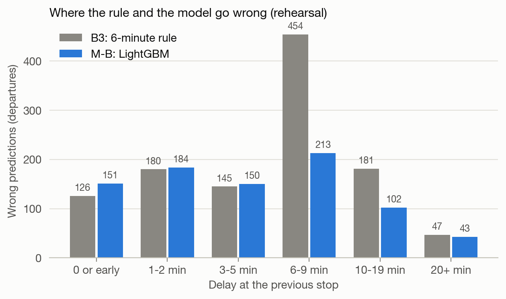
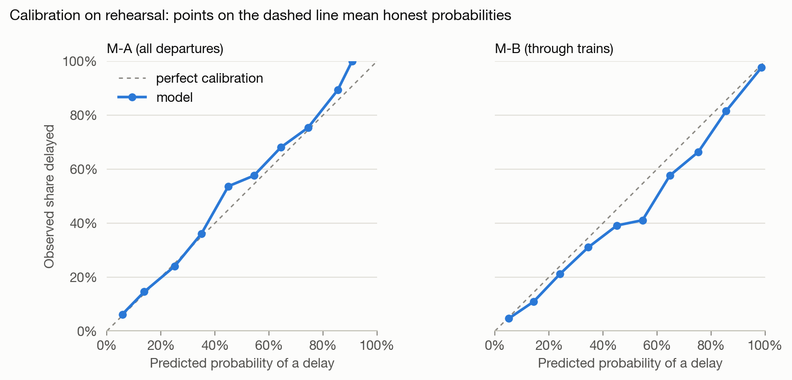

# Error analysis (rehearsal)

Written by `src/06_error_analysis.py` from the scores of `src/05_train.py`. Set: rehearsal (45,993 departures in scenario A, 8,020 through trains with an earlier stop in scenario B). Slices with fewer than 300 departures are left out. All slice values are in `reports/checks/error_slices_rehearsal.csv`.

## 1. Scenario A by service: is M-A more than a service detector?

PR-AUC and ROC-AUC are computed inside each service, where the service itself can no longer help.

| service | n | base_rate | pr_auc b2 | pr_auc m_a | roc_auc b2 | roc_auc m_a |
| --- | --- | --- | --- | --- | --- | --- |
| long_distance | 15,248 | 0.437 | 0.532 | 0.616 | 0.616 | 0.693 |
| night | 1,384 | 0.677 | 0.819 | 0.909 | 0.721 | 0.838 |
| regional | 29,345 | 0.086 | 0.141 | 0.161 | 0.628 | 0.668 |

## 2. Scenario A by time, day type and weather (M-A)

| hour_band | n | base_rate | mean_predicted | pr_auc | roc_auc | precision | recall | f1 |
| --- | --- | --- | --- | --- | --- | --- | --- | --- |
| 00-05 | 3,533 | 0.378 | 0.353 | 0.838 | 0.883 | 0.703 | 0.837 | 0.764 |
| 06-09 | 9,169 | 0.152 | 0.139 | 0.413 | 0.771 | 0.431 | 0.368 | 0.397 |
| 10-15 | 15,785 | 0.194 | 0.182 | 0.509 | 0.805 | 0.486 | 0.638 | 0.552 |
| 16-19 | 10,834 | 0.227 | 0.216 | 0.578 | 0.826 | 0.525 | 0.706 | 0.602 |
| 20-23 | 6,672 | 0.280 | 0.256 | 0.605 | 0.810 | 0.575 | 0.727 | 0.642 |

| weekday_name | n | base_rate | mean_predicted | pr_auc | roc_auc | precision | recall | f1 |
| --- | --- | --- | --- | --- | --- | --- | --- | --- |
| Fri | 6,851 | 0.235 | 0.215 | 0.619 | 0.826 | 0.552 | 0.678 | 0.609 |
| Mon | 6,729 | 0.201 | 0.196 | 0.545 | 0.809 | 0.501 | 0.629 | 0.557 |
| Sat | 6,113 | 0.211 | 0.187 | 0.592 | 0.827 | 0.539 | 0.627 | 0.580 |
| Sun | 5,956 | 0.172 | 0.180 | 0.563 | 0.842 | 0.486 | 0.656 | 0.558 |
| Thu | 6,851 | 0.244 | 0.220 | 0.603 | 0.798 | 0.540 | 0.646 | 0.589 |
| Tue | 6,948 | 0.234 | 0.215 | 0.604 | 0.825 | 0.553 | 0.678 | 0.609 |
| Wed | 6,545 | 0.236 | 0.219 | 0.634 | 0.828 | 0.558 | 0.696 | 0.620 |

| month | n | base_rate | mean_predicted | pr_auc | roc_auc | precision | recall | f1 |
| --- | --- | --- | --- | --- | --- | --- | --- | --- |
| 2026-01 | 6,894 | 0.294 | 0.220 | 0.714 | 0.842 | 0.654 | 0.696 | 0.675 |
| 2026-02 | 7,155 | 0.211 | 0.226 | 0.615 | 0.838 | 0.504 | 0.720 | 0.593 |
| 2026-03 | 8,125 | 0.207 | 0.191 | 0.545 | 0.800 | 0.498 | 0.591 | 0.541 |
| 2026-04 | 7,747 | 0.190 | 0.191 | 0.534 | 0.800 | 0.477 | 0.618 | 0.538 |
| 2026-05 | 8,011 | 0.185 | 0.191 | 0.505 | 0.807 | 0.467 | 0.620 | 0.533 |
| 2026-06 | 8,061 | 0.241 | 0.217 | 0.645 | 0.844 | 0.593 | 0.698 | 0.641 |

| day_type | n | base_rate | mean_predicted | pr_auc | roc_auc | precision | recall | f1 |
| --- | --- | --- | --- | --- | --- | --- | --- | --- |
| bridge day | 1,025 | 0.182 | 0.210 | 0.589 | 0.859 | 0.467 | 0.749 | 0.575 |
| normal day | 36,470 | 0.228 | 0.209 | 0.605 | 0.821 | 0.542 | 0.664 | 0.597 |
| public holiday | 1,840 | 0.160 | 0.183 | 0.507 | 0.827 | 0.453 | 0.616 | 0.522 |
| school holiday | 6,658 | 0.199 | 0.194 | 0.572 | 0.822 | 0.527 | 0.636 | 0.576 |

| precipitation | n | base_rate | mean_predicted | pr_auc | roc_auc | precision | recall | f1 |
| --- | --- | --- | --- | --- | --- | --- | --- | --- |
| dry hour | 37,344 | 0.220 | 0.205 | 0.600 | 0.823 | 0.539 | 0.657 | 0.593 |
| rain or snow in the hour | 8,649 | 0.220 | 0.208 | 0.586 | 0.817 | 0.519 | 0.673 | 0.586 |

| wind | n | base_rate | mean_predicted | pr_auc | roc_auc | precision | recall | f1 |
| --- | --- | --- | --- | --- | --- | --- | --- | --- |
| gusts 50 km/h or more | 1,132 | 0.159 | 0.193 | 0.468 | 0.810 | 0.403 | 0.683 | 0.507 |
| gusts under 50 km/h | 44,861 | 0.221 | 0.206 | 0.600 | 0.822 | 0.539 | 0.660 | 0.593 |

| frost | n | base_rate | mean_predicted | pr_auc | roc_auc | precision | recall | f1 |
| --- | --- | --- | --- | --- | --- | --- | --- | --- |
| 0 °C or warmer | 40,919 | 0.213 | 0.204 | 0.580 | 0.819 | 0.520 | 0.659 | 0.581 |
| below 0 °C | 5,074 | 0.277 | 0.213 | 0.716 | 0.845 | 0.655 | 0.670 | 0.662 |

## 3. Scenario A by regional line (M-A)

| line | n | base_rate | mean_predicted | pr_auc | roc_auc | recall |
| --- | --- | --- | --- | --- | --- | --- |
| (no line: long-distance, night) | 16,648 | 0.457 | 0.428 | 0.678 | 0.715 | 0.876 |
| RB53 | 6,799 | 0.082 | 0.079 | 0.159 | 0.639 | 0.025 |
| RB79 | 477 | 0.128 | 0.095 | 0.164 | 0.601 | 0.000 |
| RB80 | 690 | 0.074 | 0.105 | 0.077 | 0.544 | 0.000 |
| RB85 | 2,590 | 0.041 | 0.046 | 0.051 | 0.569 | 0.000 |
| RE10 | 4,488 | 0.122 | 0.120 | 0.183 | 0.615 | 0.000 |
| RE20 | 1,567 | 0.036 | 0.036 | 0.067 | 0.653 | 0.000 |
| RE54 | 2,754 | 0.093 | 0.067 | 0.224 | 0.685 | 0.000 |
| RE55 | 2,291 | 0.090 | 0.061 | 0.164 | 0.620 | 0.010 |
| RE7 | 2,406 | 0.044 | 0.043 | 0.102 | 0.600 | 0.000 |
| RE8 | 2,085 | 0.160 | 0.130 | 0.220 | 0.647 | 0.000 |
| RE80 | 2,944 | 0.062 | 0.070 | 0.072 | 0.578 | 0.000 |

## 4. Scenario B by service and horizon

| service | n | base_rate | pr_auc m_a_prime | pr_auc b3 | pr_auc m_b |
| --- | --- | --- | --- | --- | --- |
| long_distance | 5,241 | 0.437 | 0.623 | 0.922 | 0.939 |
| night | 457 | 0.648 | 0.833 | 0.901 | 0.943 |
| regional | 2,306 | 0.090 | 0.168 | 0.670 | 0.757 |

| horizon | n | base_rate | pr_auc m_a_prime | pr_auc b3 | pr_auc m_b |
| --- | --- | --- | --- | --- | --- |
| 10-20 min | 1,417 | 0.080 | 0.144 | 0.696 | 0.727 |
| 20-45 min | 3,036 | 0.434 | 0.631 | 0.922 | 0.963 |
| over 45 min | 3,567 | 0.385 | 0.646 | 0.860 | 0.905 |

## 5. Scenario B: the rule against the model, by delay at the previous stop

Share of right decisions: B3 with its 6-minute rule, M-B at its validation threshold (0.402).

| previous_stop_delay | n | share_delayed | accuracy_rule | accuracy_model | errors_rule | errors_model |
| --- | --- | --- | --- | --- | --- | --- |
| 0 or early | 2,147 | 0.059 | 0.941 | 0.930 | 126 | 151 |
| 1-2 min | 1,831 | 0.098 | 0.902 | 0.900 | 180 | 184 |
| 3-5 min | 1,008 | 0.144 | 0.856 | 0.851 | 145 | 150 |
| 6-9 min | 725 | 0.374 | 0.374 | 0.706 | 454 | 213 |
| 10-19 min | 908 | 0.801 | 0.801 | 0.888 | 181 | 102 |
| 20+ min | 1,401 | 0.966 | 0.966 | 0.969 | 47 | 43 |

## 6. Calibration

**M-A (all departures)** — expected calibration error 0.016

| range | n | mean_predicted | observed_rate |
| --- | --- | --- | --- |
| 0.0-0.1 | 21,798 | 0.057 | 0.062 |
| 0.1-0.2 | 7,704 | 0.138 | 0.145 |
| 0.2-0.3 | 3,779 | 0.251 | 0.240 |
| 0.3-0.4 | 4,023 | 0.350 | 0.361 |
| 0.4-0.5 | 4,152 | 0.449 | 0.536 |
| 0.5-0.6 | 2,090 | 0.544 | 0.576 |
| 0.6-0.7 | 1,114 | 0.644 | 0.680 |
| 0.7-0.8 | 628 | 0.744 | 0.753 |
| 0.8-0.9 | 680 | 0.854 | 0.893 |
| 0.9-1.0 | 25 | 0.907 | 1.000 |

**M-B (through trains)** — expected calibration error 0.020

| range | n | mean_predicted | observed_rate |
| --- | --- | --- | --- |
| 0.0-0.1 | 3,182 | 0.051 | 0.046 |
| 0.1-0.2 | 1,431 | 0.143 | 0.108 |
| 0.2-0.3 | 474 | 0.240 | 0.211 |
| 0.3-0.4 | 242 | 0.345 | 0.310 |
| 0.4-0.5 | 202 | 0.451 | 0.391 |
| 0.5-0.6 | 134 | 0.546 | 0.410 |
| 0.6-0.7 | 118 | 0.647 | 0.576 |
| 0.7-0.8 | 113 | 0.753 | 0.664 |
| 0.8-0.9 | 157 | 0.856 | 0.815 |
| 0.9-1.0 | 1,967 | 0.986 | 0.977 |

## 7. Confusion matrices

**M-A**, threshold 0.306

|  | predicted on time | predicted delayed |
| --- | --- | --- |
| actually on time | 30,080 | 5,797 |
| actually delayed | 3,437 | 6,679 |

**M-B**, threshold 0.402

|  | predicted on time | predicted delayed |
| --- | --- | --- |
| actually on time | 4,852 | 365 |
| actually delayed | 478 | 2,325 |

**B3**, rule at 6 minutes

|  | predicted on time | predicted delayed |
| --- | --- | --- |
| actually on time | 4,535 | 682 |
| actually delayed | 451 | 2,352 |

## 8. The 20 largest errors

Rows where the predicted probability is furthest from what happened. `score` is the predicted probability, `dep_delay` the realised delay in minutes (used here for the analysis only).

**M-A**

| planned | train | destination | delayed | dep_delay | score | hist_rate_route | failure_type |
| --- | --- | --- | --- | --- | --- | --- | --- |
| 2026-03-07 14:35 | RE 4789 | Nürnberg Hbf | 1 | 6.000 | 0.022 | 0.028 | missed, just over the threshold (6-8 min) |
| 2026-04-26 14:35 | RE 4789 | Nürnberg Hbf | 1 | 7.000 | 0.022 | 0.050 | missed, just over the threshold (6-8 min) |
| 2026-04-16 06:35 | RE 4781 | Nürnberg Hbf | 1 | 13.000 | 0.023 | 0.029 | missed, moderate delay (9-29 min) on a usually punctual train |
| 2026-06-23 06:35 | RE 4781 | Nürnberg Hbf | 1 | 10.000 | 0.023 | 0.033 | missed, moderate delay (9-29 min) on a usually punctual train |
| 2026-04-25 10:35 | RE 4785 | Nürnberg Hbf | 1 | 6.000 | 0.023 | 0.050 | missed, just over the threshold (6-8 min) |
| 2026-01-15 14:35 | RE 4789 | Nürnberg Hbf | 1 | 6.000 | 0.024 | 0.004 | missed, just over the threshold (6-8 min) |
| 2026-03-12 14:35 | RE 4789 | Nürnberg Hbf | 1 | 6.000 | 0.025 | 0.028 | missed, just over the threshold (6-8 min) |
| 2026-06-12 06:35 | RE 4781 | Nürnberg Hbf | 1 | 14.000 | 0.025 | 0.017 | missed, moderate delay (9-29 min) on a usually punctual train |
| 2026-03-12 16:35 | RE 4791 | Nürnberg Hbf | 1 | 8.000 | 0.025 | 0.028 | missed, just over the threshold (6-8 min) |
| 2026-01-18 13:12 | RB 57967 | Lauda | 1 | 11.000 | 0.025 | 0.064 | missed, moderate delay (9-29 min) on a usually punctual train |
| 2026-04-15 12:35 | RE 4787 | Nürnberg Hbf | 1 | 9.000 | 0.025 | 0.029 | missed, moderate delay (9-29 min) on a usually punctual train |
| 2026-03-24 12:35 | RE 4787 | Nürnberg Hbf | 1 | 25.000 | 0.026 | 0.025 | missed, moderate delay (9-29 min) on a usually punctual train |
| 2026-06-18 10:35 | RE 4785 | Nürnberg Hbf | 1 | 9.000 | 0.026 | 0.025 | missed, moderate delay (9-29 min) on a usually punctual train |
| 2026-03-04 12:35 | RE 4787 | Nürnberg Hbf | 1 | 7.000 | 0.026 | 0.028 | missed, just over the threshold (6-8 min) |
| 2026-04-03 12:35 | RE 4787 | Nürnberg Hbf | 1 | 73.000 | 0.026 | 0.029 | missed, major delay (30+ min) |
| 2026-06-13 14:35 | RE 4789 | Nürnberg Hbf | 1 | 62.000 | 0.026 | 0.017 | missed, major delay (30+ min) |
| 2026-05-26 16:35 | RE 4791 | Nürnberg Hbf | 1 | 7.000 | 0.027 | 0.025 | missed, just over the threshold (6-8 min) |
| 2026-04-16 08:35 | RE 4783 | Nürnberg Hbf | 1 | 6.000 | 0.027 | 0.029 | missed, just over the threshold (6-8 min) |
| 2026-04-09 14:35 | RE 4789 | Nürnberg Hbf | 1 | 11.000 | 0.027 | 0.034 | missed, moderate delay (9-29 min) on a usually punctual train |
| 2026-05-07 08:35 | RE 4783 | Nürnberg Hbf | 1 | 8.000 | 0.028 | 0.057 | missed, just over the threshold (6-8 min) |

| failure type | rows |
| --- | --- |
| missed, just over the threshold (6-8 min) | 10 |
| missed, moderate delay (9-29 min) on a usually punctual train | 8 |
| missed, major delay (30+ min) | 2 |

**M-B**

| planned | train | destination | delayed | dep_delay | score | prev_delay | prev_minutes_to_departure | failure_type |
| --- | --- | --- | --- | --- | --- | --- | --- | --- |
| 2026-05-25 02:36 | NJ 40420 | Hamburg-Altona | 0 | 4.000 | 0.999 | 31.000 | 54.000 | false alarm, just under the threshold (4-5 min) |
| 2026-06-19 02:05 | NJ 40421 | Wien Hbf | 0 | 1.000 | 0.991 | 104.000 | 183.000 | false alarm, train made up its delay before Würzburg |
| 2026-06-19 02:05 | NJ 421 | Innsbruck Hbf | 0 | 1.000 | 0.991 | 104.000 | 183.000 | false alarm, train made up its delay before Würzburg |
| 2026-05-08 04:26 | ICE 1081 | München Hbf | 0 | 3.000 | 0.989 | 34.000 | 127.000 | false alarm, train made up its delay before Würzburg |
| 2026-06-28 11:01 | RB 58024 | Flieden | 1 | 24.000 | 0.011 | 1.000 | 16.000 | missed, delay arose after an on-time previous stop |
| 2026-05-11 17:38 | RE 4621 | Bamberg | 1 | 6.000 | 0.013 | 0.000 | 33.000 | missed, just over the threshold (6-8 min) |
| 2026-06-28 19:38 | RE 4625 | Bamberg | 1 | 14.000 | 0.015 | 2.000 | 33.000 | missed, delay arose after an on-time previous stop |
| 2026-06-22 15:01 | RB 58044 | Flieden | 1 | 7.000 | 0.016 | 0.000 | 16.000 | missed, just over the threshold (6-8 min) |
| 2026-06-03 15:01 | RB 58044 | Flieden | 1 | 6.000 | 0.019 | 0.000 | 16.000 | missed, just over the threshold (6-8 min) |
| 2026-06-30 01:39 | NJ 40421 | Wien Hbf | 0 | 1.000 | 0.980 | 31.000 | 126.000 | false alarm, train made up its delay before Würzburg |
| 2026-06-30 18:01 | RB 58060 | Flieden | 1 | 6.000 | 0.020 | 0.000 | 16.000 | missed, just over the threshold (6-8 min) |
| 2026-06-11 13:01 | RB 58032 | Flieden | 1 | 6.000 | 0.020 | 0.000 | 16.000 | missed, just over the threshold (6-8 min) |
| 2026-06-30 01:39 | NJ 421 | Innsbruck Hbf | 0 | 1.000 | 0.979 | 31.000 | 126.000 | false alarm, train made up its delay before Würzburg |
| 2026-05-02 02:50 | NJ 421 | Innsbruck Hbf | 0 | 1.000 | 0.978 | 42.000 | 140.000 | false alarm, train made up its delay before Würzburg |
| 2026-05-02 02:50 | NJ 40421 | Wien Hbf | 0 | 1.000 | 0.978 | 42.000 | 140.000 | false alarm, train made up its delay before Würzburg |
| 2026-05-19 03:01 | NJ 421 | Innsbruck Hbf | 0 | 1.000 | 0.977 | 73.000 | 179.000 | false alarm, train made up its delay before Würzburg |
| 2026-05-19 03:01 | NJ 40421 | Wien Hbf | 0 | 1.000 | 0.977 | 73.000 | 179.000 | false alarm, train made up its delay before Würzburg |
| 2026-05-30 13:42 | ICE 1225 | Wien Hbf | 0 | 2.000 | 0.976 | 30.000 | 120.000 | false alarm, train made up its delay before Würzburg |
| 2026-06-28 14:08 | RB 58043 | Bamberg | 1 | 43.000 | 0.025 | 7.000 | 15.000 | missed, major delay (30+ min) |
| 2026-06-20 18:37 | RE 4628 | Frankfurt(Main)Hbf | 1 | 6.000 | 0.027 | 2.000 | 41.000 | missed, just over the threshold (6-8 min) |

| failure type | rows |
| --- | --- |
| false alarm, train made up its delay before Würzburg | 10 |
| missed, just over the threshold (6-8 min) | 6 |
| missed, delay arose after an on-time previous stop | 2 |
| false alarm, just under the threshold (4-5 min) | 1 |
| missed, major delay (30+ min) | 1 |
