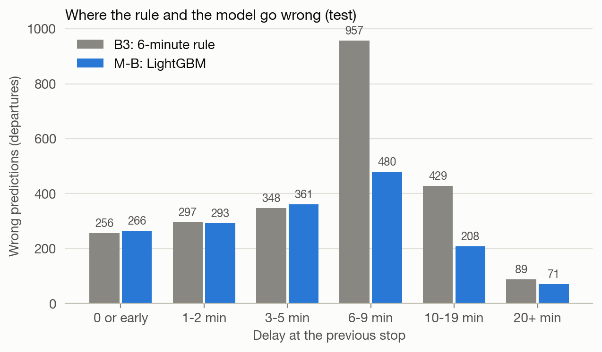
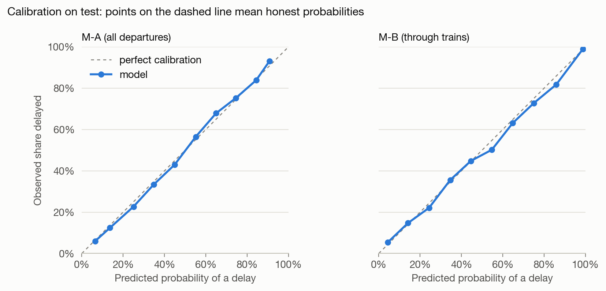

# Error analysis (test)

Written by `src/06_error_analysis.py` from the scores of `src/05_train.py`. Set: test (31,956 departures in scenario A, 15,898 through trains with an earlier stop in scenario B). Slices with fewer than 300 departures are left out. All slice values are in `reports/checks/error_slices_test.csv`.

## 1. Scenario A by service: is M-A more than a service detector?

PR-AUC and ROC-AUC are computed inside each service, where the service itself can no longer help.

| service | n | base_rate | pr_auc b2 | pr_auc m_a | roc_auc b2 | roc_auc m_a |
| --- | --- | --- | --- | --- | --- | --- |
| long_distance | 10,410 | 0.480 | 0.566 | 0.685 | 0.611 | 0.719 |
| night | 766 | 0.727 | 0.826 | 0.854 | 0.658 | 0.696 |
| regional | 20,751 | 0.086 | 0.135 | 0.159 | 0.619 | 0.657 |

## 2. Scenario A by time, day type and weather (M-A)

| hour_band | n | base_rate | mean_predicted | pr_auc | roc_auc | precision | recall | f1 |
| --- | --- | --- | --- | --- | --- | --- | --- | --- |
| 00-05 | 2,229 | 0.372 | 0.365 | 0.787 | 0.860 | 0.673 | 0.853 | 0.753 |
| 06-09 | 6,371 | 0.164 | 0.159 | 0.486 | 0.795 | 0.435 | 0.555 | 0.488 |
| 10-15 | 10,996 | 0.211 | 0.222 | 0.603 | 0.838 | 0.519 | 0.731 | 0.607 |
| 16-19 | 7,776 | 0.239 | 0.252 | 0.629 | 0.830 | 0.543 | 0.720 | 0.619 |
| 20-23 | 4,584 | 0.284 | 0.282 | 0.638 | 0.817 | 0.575 | 0.738 | 0.647 |

| weekday_name | n | base_rate | mean_predicted | pr_auc | roc_auc | precision | recall | f1 |
| --- | --- | --- | --- | --- | --- | --- | --- | --- |
| Fri | 4,868 | 0.244 | 0.249 | 0.659 | 0.843 | 0.557 | 0.737 | 0.635 |
| Mon | 4,550 | 0.213 | 0.219 | 0.608 | 0.836 | 0.532 | 0.708 | 0.608 |
| Sat | 4,314 | 0.195 | 0.216 | 0.577 | 0.832 | 0.488 | 0.702 | 0.576 |
| Sun | 3,927 | 0.174 | 0.205 | 0.501 | 0.819 | 0.446 | 0.686 | 0.541 |
| Thu | 4,850 | 0.269 | 0.253 | 0.688 | 0.837 | 0.599 | 0.736 | 0.660 |
| Tue | 4,588 | 0.245 | 0.247 | 0.635 | 0.823 | 0.547 | 0.710 | 0.618 |
| Wed | 4,859 | 0.255 | 0.250 | 0.653 | 0.825 | 0.564 | 0.726 | 0.635 |

| month | n | base_rate | mean_predicted | pr_auc | roc_auc | precision | recall | f1 |
| --- | --- | --- | --- | --- | --- | --- | --- | --- |
| 2026-07 | 8,269 | 0.266 | 0.266 | 0.656 | 0.824 | 0.560 | 0.730 | 0.634 |
| 2026-08 | 7,751 | 0.229 | 0.241 | 0.589 | 0.823 | 0.533 | 0.709 | 0.608 |
| 2026-09 | 7,780 | 0.223 | 0.221 | 0.652 | 0.849 | 0.557 | 0.728 | 0.631 |
| 2026-10 | 8,156 | 0.201 | 0.213 | 0.607 | 0.833 | 0.505 | 0.701 | 0.587 |

| day_type | n | base_rate | mean_predicted | pr_auc | roc_auc | precision | recall | f1 |
| --- | --- | --- | --- | --- | --- | --- | --- | --- |
| normal day | 20,848 | 0.231 | 0.237 | 0.632 | 0.831 | 0.535 | 0.719 | 0.614 |
| public holiday | 444 | 0.187 | 0.213 | 0.550 | 0.800 | 0.455 | 0.675 | 0.544 |
| school holiday | 10,664 | 0.230 | 0.233 | 0.627 | 0.838 | 0.552 | 0.718 | 0.624 |

| precipitation | n | base_rate | mean_predicted | pr_auc | roc_auc | precision | recall | f1 |
| --- | --- | --- | --- | --- | --- | --- | --- | --- |
| dry hour | 27,652 | 0.230 | 0.236 | 0.630 | 0.833 | 0.541 | 0.720 | 0.618 |
| rain or snow in the hour | 4,304 | 0.228 | 0.232 | 0.626 | 0.833 | 0.533 | 0.707 | 0.608 |

| wind | n | base_rate | mean_predicted | pr_auc | roc_auc | precision | recall | f1 |
| --- | --- | --- | --- | --- | --- | --- | --- | --- |
| gusts 50 km/h or more | 755 | 0.240 | 0.241 | 0.626 | 0.836 | 0.553 | 0.691 | 0.614 |
| gusts under 50 km/h | 31,201 | 0.230 | 0.235 | 0.629 | 0.833 | 0.539 | 0.719 | 0.616 |

| frost | n | base_rate | mean_predicted | pr_auc | roc_auc | precision | recall | f1 |
| --- | --- | --- | --- | --- | --- | --- | --- | --- |
| 0 °C or warmer | 31,956 | 0.230 | 0.235 | 0.629 | 0.833 | 0.540 | 0.718 | 0.616 |

## 3. Scenario A by regional line (M-A)

| line | n | base_rate | mean_predicted | pr_auc | roc_auc | recall |
| --- | --- | --- | --- | --- | --- | --- |
| (no line: long-distance, night) | 11,205 | 0.497 | 0.500 | 0.711 | 0.726 | 0.944 |
| RB53 | 4,667 | 0.090 | 0.100 | 0.146 | 0.624 | 0.019 |
| RB79 | 308 | 0.101 | 0.095 | 0.142 | 0.592 | 0.000 |
| RB80 | 608 | 0.112 | 0.130 | 0.161 | 0.593 | 0.000 |
| RB85 | 1,984 | 0.042 | 0.050 | 0.064 | 0.641 | 0.000 |
| RE10 | 3,138 | 0.122 | 0.131 | 0.176 | 0.594 | 0.010 |
| RE20 | 1,042 | 0.043 | 0.045 | 0.060 | 0.606 | 0.000 |
| RE54 | 1,920 | 0.092 | 0.093 | 0.191 | 0.652 | 0.011 |
| RE55 | 1,518 | 0.088 | 0.074 | 0.153 | 0.628 | 0.000 |
| RE7 | 1,340 | 0.049 | 0.052 | 0.073 | 0.557 | 0.000 |
| RE8 | 1,782 | 0.116 | 0.119 | 0.294 | 0.728 | 0.044 |
| RE80 | 2,240 | 0.065 | 0.079 | 0.084 | 0.580 | 0.000 |

## 4. Scenario B by service and horizon

| service | n | base_rate | pr_auc m_a_prime | pr_auc b3 | pr_auc m_b |
| --- | --- | --- | --- | --- | --- |
| long_distance | 10,353 | 0.481 | 0.683 | 0.928 | 0.944 |
| night | 752 | 0.730 | 0.857 | 0.939 | 0.966 |
| regional | 4,764 | 0.093 | 0.153 | 0.634 | 0.727 |

| horizon | n | base_rate | pr_auc m_a_prime | pr_auc b3 | pr_auc m_b |
| --- | --- | --- | --- | --- | --- |
| 10-20 min | 2,902 | 0.088 | 0.124 | 0.670 | 0.709 |
| 20-45 min | 6,146 | 0.465 | 0.729 | 0.923 | 0.970 |
| over 45 min | 6,850 | 0.419 | 0.657 | 0.874 | 0.908 |

## 5. Scenario B: the rule against the model, by delay at the previous stop

Share of right decisions: B3 with its 6-minute rule, M-B at its validation threshold (0.428).

| previous_stop_delay | n | share_delayed | accuracy_rule | accuracy_model | errors_rule | errors_model |
| --- | --- | --- | --- | --- | --- | --- |
| 0 or early | 3,831 | 0.067 | 0.933 | 0.931 | 256 | 266 |
| 1-2 min | 3,312 | 0.090 | 0.910 | 0.912 | 297 | 293 |
| 3-5 min | 2,196 | 0.158 | 0.842 | 0.836 | 348 | 361 |
| 6-9 min | 1,648 | 0.419 | 0.419 | 0.709 | 957 | 480 |
| 10-19 min | 2,069 | 0.793 | 0.793 | 0.899 | 429 | 208 |
| 20+ min | 2,842 | 0.969 | 0.969 | 0.975 | 89 | 71 |

## 6. Calibration

**M-A (all departures)** — expected calibration error 0.011

| range | n | mean_predicted | observed_rate |
| --- | --- | --- | --- |
| 0.0-0.1 | 13,688 | 0.064 | 0.060 |
| 0.1-0.2 | 6,537 | 0.136 | 0.124 |
| 0.2-0.3 | 2,190 | 0.250 | 0.226 |
| 0.3-0.4 | 2,103 | 0.348 | 0.334 |
| 0.4-0.5 | 1,917 | 0.449 | 0.430 |
| 0.5-0.6 | 1,971 | 0.551 | 0.565 |
| 0.6-0.7 | 1,916 | 0.649 | 0.678 |
| 0.7-0.8 | 1,059 | 0.744 | 0.752 |
| 0.8-0.9 | 488 | 0.843 | 0.838 |
| 0.9-1.0 | 87 | 0.908 | 0.931 |

**M-B (through trains)** — expected calibration error 0.010

| range | n | mean_predicted | observed_rate |
| --- | --- | --- | --- |
| 0.0-0.1 | 6,632 | 0.043 | 0.053 |
| 0.1-0.2 | 2,228 | 0.142 | 0.147 |
| 0.2-0.3 | 978 | 0.243 | 0.221 |
| 0.3-0.4 | 585 | 0.346 | 0.356 |
| 0.4-0.5 | 355 | 0.446 | 0.448 |
| 0.5-0.6 | 277 | 0.547 | 0.502 |
| 0.6-0.7 | 249 | 0.648 | 0.631 |
| 0.7-0.8 | 202 | 0.750 | 0.728 |
| 0.8-0.9 | 372 | 0.858 | 0.817 |
| 0.9-1.0 | 4,020 | 0.987 | 0.989 |

## 7. Confusion matrices

**M-A**, threshold 0.289

|  | predicted on time | predicted delayed |
| --- | --- | --- |
| actually on time | 20,105 | 4,502 |
| actually delayed | 2,070 | 5,279 |

**M-B**, threshold 0.428

|  | predicted on time | predicted delayed |
| --- | --- | --- |
| actually on time | 9,392 | 521 |
| actually delayed | 1,158 | 4,827 |

**B3**, rule at 6 minutes

|  | predicted on time | predicted delayed |
| --- | --- | --- |
| actually on time | 8,438 | 1,475 |
| actually delayed | 901 | 5,084 |

## 8. The 20 largest errors

Rows where the predicted probability is furthest from what happened. `score` is the predicted probability, `dep_delay` the realised delay in minutes (used here for the analysis only).

**M-A**

| planned | train | destination | delayed | dep_delay | score | hist_rate_route | failure_type |
| --- | --- | --- | --- | --- | --- | --- | --- |
| 2026-10-20 06:35 | RE 4781 | Nürnberg Hbf | 1 | 6.000 | 0.028 | 0.016 | missed, just over the threshold (6-8 min) |
| 2026-07-25 06:35 | RE 4781 | Nürnberg Hbf | 1 | 6.000 | 0.028 | 0.069 | missed, just over the threshold (6-8 min) |
| 2026-07-02 06:35 | RE 4781 | Nürnberg Hbf | 1 | 12.000 | 0.029 | 0.053 | missed, moderate delay (9-29 min) on a usually punctual train |
| 2026-07-18 08:35 | RE 4783 | Nürnberg Hbf | 1 | 6.000 | 0.029 | 0.069 | missed, just over the threshold (6-8 min) |
| 2026-10-11 14:35 | RE 4789 | Nürnberg Hbf | 1 | 6.000 | 0.030 | 0.025 | missed, just over the threshold (6-8 min) |
| 2026-09-15 10:35 | RE 4785 | Nürnberg Hbf | 1 | 9.000 | 0.031 | 0.040 | missed, moderate delay (9-29 min) on a usually punctual train |
| 2026-10-04 08:06 | RB 57957 | Lauda | 1 | 21.000 | 0.031 | 0.031 | missed, moderate delay (9-29 min) on a usually punctual train |
| 2026-09-29 10:35 | RE 4785 | Nürnberg Hbf | 1 | 6.000 | 0.031 | 0.037 | missed, just over the threshold (6-8 min) |
| 2026-08-15 08:06 | RB 57957 | Lauda | 1 | 8.000 | 0.032 | 0.035 | missed, just over the threshold (6-8 min) |
| 2026-07-19 08:06 | RB 57957 | Lauda | 1 | 7.000 | 0.032 | 0.045 | missed, just over the threshold (6-8 min) |
| 2026-08-23 12:06 | RB 57965 | Lauda | 1 | 6.000 | 0.032 | 0.035 | missed, just over the threshold (6-8 min) |
| 2026-09-14 14:35 | RE 4789 | Nürnberg Hbf | 1 | 8.000 | 0.032 | 0.049 | missed, just over the threshold (6-8 min) |
| 2026-08-15 07:00 | RB 58006 | Flieden | 1 | 6.000 | 0.032 | 0.087 | missed, just over the threshold (6-8 min) |
| 2026-09-21 12:01 | RE 3776 | Bad Kissingen | 1 | 12.000 | 0.032 | 0.014 | missed, moderate delay (9-29 min) on a usually punctual train |
| 2026-08-19 06:35 | RE 4781 | Nürnberg Hbf | 1 | 11.000 | 0.033 | 0.069 | missed, moderate delay (9-29 min) on a usually punctual train |
| 2026-09-21 12:01 | RE 3756 | Zella-Mehlis | 1 | 12.000 | 0.033 | 0.014 | missed, moderate delay (9-29 min) on a usually punctual train |
| 2026-09-13 07:06 | RB 57955 | Lauda | 1 | 11.000 | 0.033 | 0.031 | missed, moderate delay (9-29 min) on a usually punctual train |
| 2026-08-24 08:01 | RE 3752 | Zella-Mehlis | 1 | 12.000 | 0.034 | 0.060 | missed, moderate delay (9-29 min) on a usually punctual train |
| 2026-07-17 08:35 | RE 4783 | Nürnberg Hbf | 1 | 31.000 | 0.034 | 0.073 | missed, major delay (30+ min) |
| 2026-08-24 08:01 | RE 3772 | Bad Kissingen | 1 | 12.000 | 0.034 | 0.060 | missed, moderate delay (9-29 min) on a usually punctual train |

| failure type | rows |
| --- | --- |
| missed, just over the threshold (6-8 min) | 10 |
| missed, moderate delay (9-29 min) on a usually punctual train | 9 |
| missed, major delay (30+ min) | 1 |

**M-B**

| planned | train | destination | delayed | dep_delay | score | prev_delay | prev_minutes_to_departure | failure_type |
| --- | --- | --- | --- | --- | --- | --- | --- | --- |
| 2026-07-19 13:01 | RB 58032 | Flieden | 1 | 14.000 | 0.007 | 0.000 | 16.000 | missed, delay arose after an on-time previous stop |
| 2026-08-02 13:07 | RB 58041 | Bamberg | 1 | 6.000 | 0.008 | 0.000 | 14.000 | missed, just over the threshold (6-8 min) |
| 2026-10-11 20:08 | RB 58071 | Bamberg | 1 | 10.000 | 0.010 | 0.000 | 15.000 | missed, delay arose after an on-time previous stop |
| 2026-07-26 13:01 | RB 58032 | Flieden | 1 | 6.000 | 0.010 | 1.000 | 16.000 | missed, just over the threshold (6-8 min) |
| 2026-09-27 17:01 | RB 58054 | Flieden | 1 | 8.000 | 0.010 | 1.000 | 16.000 | missed, just over the threshold (6-8 min) |
| 2026-07-04 12:01 | RB 58028 | Jossa | 1 | 7.000 | 0.010 | 0.000 | 16.000 | missed, just over the threshold (6-8 min) |
| 2026-10-25 17:01 | RB 58054 | Flieden | 1 | 6.000 | 0.010 | 0.000 | 16.000 | missed, just over the threshold (6-8 min) |
| 2026-10-17 23:46 | ICE 1021 | Nürnberg Hbf | 0 | 5.000 | 0.990 | 16.000 | 52.000 | false alarm, just under the threshold (4-5 min) |
| 2026-07-04 10:08 | RB 58023 | Bamberg | 1 | 9.000 | 0.011 | 0.000 | 15.000 | missed, delay arose after an on-time previous stop |
| 2026-10-14 23:46 | ICE 1021 | Nürnberg Hbf | 0 | 4.000 | 0.988 | 61.000 | 112.000 | false alarm, just under the threshold (4-5 min) |
| 2026-08-01 11:07 | RB 58029 | Bamberg | 1 | 6.000 | 0.012 | 0.000 | 14.000 | missed, just over the threshold (6-8 min) |
| 2026-07-03 11:07 | RB 58027 | Bamberg | 1 | 7.000 | 0.013 | 0.000 | 14.000 | missed, just over the threshold (6-8 min) |
| 2026-08-07 09:01 | RB 58016 | Flieden | 1 | 7.000 | 0.013 | 0.000 | 17.000 | missed, just over the threshold (6-8 min) |
| 2026-09-27 08:01 | RB 58012 | Jossa | 1 | 12.000 | 0.013 | 0.000 | 11.000 | missed, delay arose after an on-time previous stop |
| 2026-10-18 19:38 | RE 4625 | Bamberg | 1 | 8.000 | 0.015 | 6.000 | 48.000 | missed, just over the threshold (6-8 min) |
| 2026-10-16 18:08 | RB 58061 | Bamberg | 1 | 6.000 | 0.015 | 0.000 | 15.000 | missed, just over the threshold (6-8 min) |
| 2026-08-06 13:34 | ICE 27 | Nürnberg Hbf | 0 | 5.000 | 0.985 | 18.000 | 59.000 | false alarm, just under the threshold (4-5 min) |
| 2026-10-24 11:07 | RB 58029 | Bamberg | 1 | 6.000 | 0.016 | 0.000 | 14.000 | missed, just over the threshold (6-8 min) |
| 2026-08-17 17:01 | RB 58054 | Flieden | 1 | 6.000 | 0.016 | 1.000 | 9.000 | missed, just over the threshold (6-8 min) |
| 2026-10-19 17:01 | RB 58054 | Flieden | 1 | 6.000 | 0.016 | 0.000 | 16.000 | missed, just over the threshold (6-8 min) |

| failure type | rows |
| --- | --- |
| missed, just over the threshold (6-8 min) | 13 |
| missed, delay arose after an on-time previous stop | 4 |
| false alarm, just under the threshold (4-5 min) | 3 |
