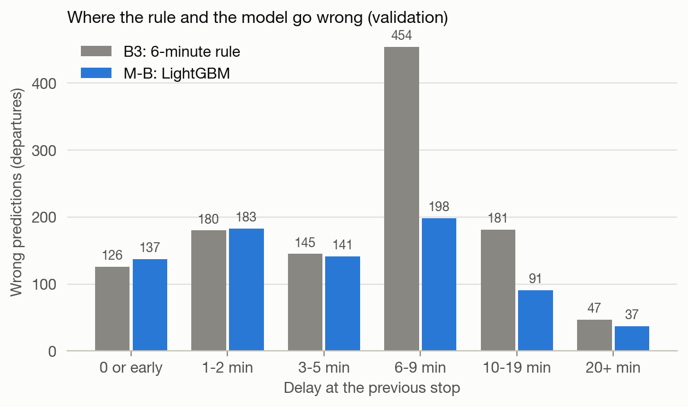
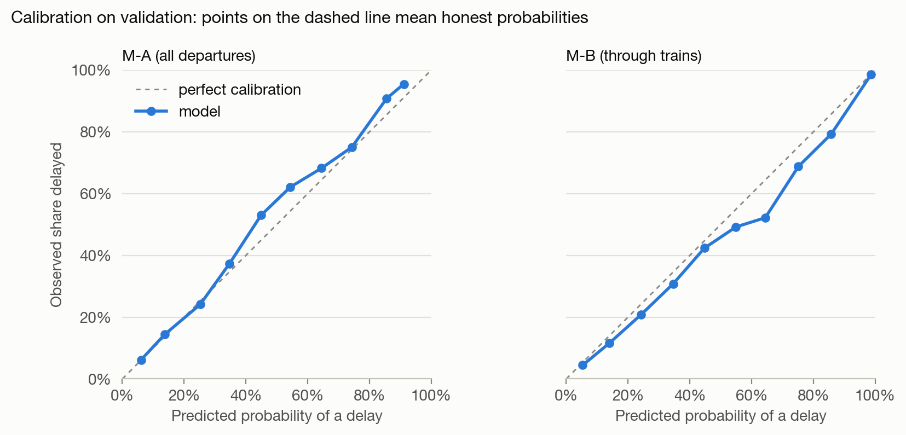

# Error analysis (validation)

Written by `src/06_error_analysis.py` from the scores of `src/05_train.py`. Set: validation (45,993 departures in scenario A, 8,020 through trains with an earlier stop in scenario B). Slices with fewer than 300 departures are left out. All slice values are in `reports/checks/error_slices_validation.csv`.

## 1. Scenario A by service: is M-A more than a service detector?

PR-AUC and ROC-AUC are computed inside each service, where the service itself can no longer help.

| service | n | base_rate | pr_auc b2 | pr_auc m_a | roc_auc b2 | roc_auc m_a |
| --- | --- | --- | --- | --- | --- | --- |
| long_distance | 15,248 | 0.437 | 0.532 | 0.630 | 0.616 | 0.701 |
| night | 1,384 | 0.677 | 0.819 | 0.909 | 0.721 | 0.832 |
| regional | 29,345 | 0.086 | 0.141 | 0.158 | 0.628 | 0.661 |

## 2. Scenario A by time, day type and weather (M-A)

| hour_band | n | base_rate | mean_predicted | pr_auc | roc_auc | precision | recall | f1 |
| --- | --- | --- | --- | --- | --- | --- | --- | --- |
| 00-05 | 3,533 | 0.378 | 0.355 | 0.835 | 0.879 | 0.699 | 0.846 | 0.765 |
| 06-09 | 9,169 | 0.152 | 0.135 | 0.400 | 0.764 | 0.429 | 0.329 | 0.373 |
| 10-15 | 15,785 | 0.194 | 0.184 | 0.511 | 0.803 | 0.476 | 0.658 | 0.553 |
| 16-19 | 10,834 | 0.227 | 0.216 | 0.602 | 0.832 | 0.523 | 0.715 | 0.604 |
| 20-23 | 6,672 | 0.280 | 0.255 | 0.622 | 0.816 | 0.575 | 0.735 | 0.645 |

| weekday_name | n | base_rate | mean_predicted | pr_auc | roc_auc | precision | recall | f1 |
| --- | --- | --- | --- | --- | --- | --- | --- | --- |
| Fri | 6,851 | 0.235 | 0.217 | 0.626 | 0.828 | 0.547 | 0.692 | 0.611 |
| Mon | 6,729 | 0.201 | 0.191 | 0.547 | 0.806 | 0.505 | 0.629 | 0.560 |
| Sat | 6,113 | 0.211 | 0.186 | 0.586 | 0.823 | 0.546 | 0.622 | 0.582 |
| Sun | 5,956 | 0.172 | 0.182 | 0.559 | 0.838 | 0.485 | 0.668 | 0.562 |
| Thu | 6,851 | 0.244 | 0.218 | 0.611 | 0.801 | 0.531 | 0.652 | 0.585 |
| Tue | 6,948 | 0.234 | 0.218 | 0.618 | 0.827 | 0.545 | 0.693 | 0.611 |
| Wed | 6,545 | 0.236 | 0.219 | 0.643 | 0.826 | 0.548 | 0.693 | 0.612 |

| month | n | base_rate | mean_predicted | pr_auc | roc_auc | precision | recall | f1 |
| --- | --- | --- | --- | --- | --- | --- | --- | --- |
| 2026-01 | 6,894 | 0.294 | 0.217 | 0.717 | 0.841 | 0.651 | 0.693 | 0.671 |
| 2026-02 | 7,155 | 0.211 | 0.226 | 0.614 | 0.837 | 0.493 | 0.731 | 0.589 |
| 2026-03 | 8,125 | 0.207 | 0.195 | 0.552 | 0.799 | 0.498 | 0.600 | 0.544 |
| 2026-04 | 7,747 | 0.190 | 0.191 | 0.549 | 0.802 | 0.479 | 0.633 | 0.546 |
| 2026-05 | 8,011 | 0.185 | 0.188 | 0.509 | 0.805 | 0.470 | 0.610 | 0.531 |
| 2026-06 | 8,061 | 0.241 | 0.218 | 0.652 | 0.845 | 0.582 | 0.710 | 0.639 |

| day_type | n | base_rate | mean_predicted | pr_auc | roc_auc | precision | recall | f1 |
| --- | --- | --- | --- | --- | --- | --- | --- | --- |
| bridge day | 1,025 | 0.182 | 0.208 | 0.596 | 0.861 | 0.465 | 0.749 | 0.574 |
| normal day | 36,470 | 0.228 | 0.207 | 0.611 | 0.820 | 0.542 | 0.665 | 0.597 |
| public holiday | 1,840 | 0.160 | 0.182 | 0.514 | 0.830 | 0.439 | 0.639 | 0.521 |
| school holiday | 6,658 | 0.199 | 0.198 | 0.575 | 0.819 | 0.505 | 0.663 | 0.574 |

| precipitation | n | base_rate | mean_predicted | pr_auc | roc_auc | precision | recall | f1 |
| --- | --- | --- | --- | --- | --- | --- | --- | --- |
| dry hour | 37,344 | 0.220 | 0.204 | 0.606 | 0.823 | 0.537 | 0.665 | 0.594 |
| rain or snow in the hour | 8,649 | 0.220 | 0.208 | 0.589 | 0.815 | 0.511 | 0.670 | 0.580 |

| wind | n | base_rate | mean_predicted | pr_auc | roc_auc | precision | recall | f1 |
| --- | --- | --- | --- | --- | --- | --- | --- | --- |
| gusts 50 km/h or more | 1,132 | 0.159 | 0.187 | 0.474 | 0.812 | 0.409 | 0.689 | 0.513 |
| gusts under 50 km/h | 44,861 | 0.221 | 0.206 | 0.605 | 0.822 | 0.535 | 0.665 | 0.593 |

| frost | n | base_rate | mean_predicted | pr_auc | roc_auc | precision | recall | f1 |
| --- | --- | --- | --- | --- | --- | --- | --- | --- |
| 0 °C or warmer | 40,919 | 0.213 | 0.205 | 0.587 | 0.819 | 0.515 | 0.665 | 0.581 |
| below 0 °C | 5,074 | 0.277 | 0.208 | 0.718 | 0.845 | 0.662 | 0.669 | 0.665 |

## 3. Scenario A by regional line (M-A)

| line | n | base_rate | mean_predicted | pr_auc | roc_auc | recall |
| --- | --- | --- | --- | --- | --- | --- |
| (no line: long-distance, night) | 16,648 | 0.457 | 0.420 | 0.686 | 0.721 | 0.884 |
| RB53 | 6,799 | 0.082 | 0.083 | 0.152 | 0.626 | 0.020 |
| RB79 | 477 | 0.128 | 0.099 | 0.172 | 0.608 | 0.000 |
| RB80 | 690 | 0.074 | 0.117 | 0.075 | 0.523 | 0.000 |
| RB85 | 2,590 | 0.041 | 0.051 | 0.048 | 0.553 | 0.000 |
| RE10 | 4,488 | 0.122 | 0.123 | 0.190 | 0.605 | 0.000 |
| RE20 | 1,567 | 0.036 | 0.039 | 0.074 | 0.672 | 0.000 |
| RE54 | 2,754 | 0.093 | 0.071 | 0.207 | 0.684 | 0.000 |
| RE55 | 2,291 | 0.090 | 0.063 | 0.161 | 0.619 | 0.000 |
| RE7 | 2,406 | 0.044 | 0.051 | 0.099 | 0.576 | 0.000 |
| RE8 | 2,085 | 0.160 | 0.132 | 0.231 | 0.653 | 0.000 |
| RE80 | 2,944 | 0.062 | 0.075 | 0.070 | 0.555 | 0.000 |

## 4. Scenario B by service and horizon

| service | n | base_rate | pr_auc m_a_prime | pr_auc b3 | pr_auc m_b |
| --- | --- | --- | --- | --- | --- |
| long_distance | 5,241 | 0.437 | 0.650 | 0.922 | 0.940 |
| night | 457 | 0.648 | 0.868 | 0.901 | 0.947 |
| regional | 2,306 | 0.090 | 0.151 | 0.670 | 0.764 |

| horizon | n | base_rate | pr_auc m_a_prime | pr_auc b3 | pr_auc m_b |
| --- | --- | --- | --- | --- | --- |
| 10-20 min | 1,417 | 0.080 | 0.121 | 0.696 | 0.736 |
| 20-45 min | 3,036 | 0.434 | 0.669 | 0.922 | 0.963 |
| over 45 min | 3,567 | 0.385 | 0.663 | 0.860 | 0.909 |

## 5. Scenario B: the rule against the model, by delay at the previous stop

Share of right decisions: B3 with its 6-minute rule, M-B at its validation threshold (0.428).

| previous_stop_delay | n | share_delayed | accuracy_rule | accuracy_model | errors_rule | errors_model |
| --- | --- | --- | --- | --- | --- | --- |
| 0 or early | 2,147 | 0.059 | 0.941 | 0.936 | 126 | 137 |
| 1-2 min | 1,831 | 0.098 | 0.902 | 0.900 | 180 | 183 |
| 3-5 min | 1,008 | 0.144 | 0.856 | 0.860 | 145 | 141 |
| 6-9 min | 725 | 0.374 | 0.374 | 0.727 | 454 | 198 |
| 10-19 min | 908 | 0.801 | 0.801 | 0.900 | 181 | 91 |
| 20+ min | 1,401 | 0.966 | 0.966 | 0.974 | 47 | 37 |

## 6. Calibration

**M-A (all departures)** — expected calibration error 0.017

| range | n | mean_predicted | observed_rate |
| --- | --- | --- | --- |
| 0.0-0.1 | 21,018 | 0.061 | 0.062 |
| 0.1-0.2 | 8,731 | 0.137 | 0.144 |
| 0.2-0.3 | 4,037 | 0.252 | 0.241 |
| 0.3-0.4 | 4,088 | 0.347 | 0.373 |
| 0.4-0.5 | 3,518 | 0.449 | 0.530 |
| 0.5-0.6 | 2,242 | 0.543 | 0.621 |
| 0.6-0.7 | 1,054 | 0.645 | 0.682 |
| 0.7-0.8 | 612 | 0.742 | 0.750 |
| 0.8-0.9 | 671 | 0.855 | 0.908 |
| 0.9-1.0 | 22 | 0.911 | 0.955 |

**M-B (through trains)** — expected calibration error 0.016

| range | n | mean_predicted | observed_rate |
| --- | --- | --- | --- |
| 0.0-0.1 | 3,290 | 0.053 | 0.044 |
| 0.1-0.2 | 1,281 | 0.140 | 0.116 |
| 0.2-0.3 | 552 | 0.243 | 0.208 |
| 0.3-0.4 | 263 | 0.346 | 0.308 |
| 0.4-0.5 | 215 | 0.447 | 0.423 |
| 0.5-0.6 | 124 | 0.549 | 0.492 |
| 0.6-0.7 | 92 | 0.644 | 0.522 |
| 0.7-0.8 | 96 | 0.751 | 0.688 |
| 0.8-0.9 | 159 | 0.857 | 0.792 |
| 0.9-1.0 | 1,948 | 0.987 | 0.986 |

## 7. Confusion matrices

**M-A**, threshold 0.289

|  | predicted on time | predicted delayed |
| --- | --- | --- |
| actually on time | 29,948 | 5,929 |
| actually delayed | 3,382 | 6,734 |

**M-B**, threshold 0.428

|  | predicted on time | predicted delayed |
| --- | --- | --- |
| actually on time | 4,942 | 275 |
| actually delayed | 512 | 2,291 |

**B3**, rule at 6 minutes

|  | predicted on time | predicted delayed |
| --- | --- | --- |
| actually on time | 4,535 | 682 |
| actually delayed | 451 | 2,352 |

## 8. The 20 largest errors

Rows where the predicted probability is furthest from what happened. `score` is the predicted probability, `dep_delay` the realised delay in minutes (used here for the analysis only).

**M-A**

| planned | train | destination | delayed | dep_delay | score | hist_rate_route | failure_type |
| --- | --- | --- | --- | --- | --- | --- | --- |
| 2026-04-25 10:35 | RE 4785 | Nürnberg Hbf | 1 | 6.000 | 0.026 | 0.050 | unclassified |
| 2026-06-23 06:35 | RE 4781 | Nürnberg Hbf | 1 | 10.000 | 0.026 | 0.033 | unclassified |
| 2026-04-16 06:35 | RE 4781 | Nürnberg Hbf | 1 | 13.000 | 0.027 | 0.029 | unclassified |
| 2026-04-26 14:35 | RE 4789 | Nürnberg Hbf | 1 | 7.000 | 0.027 | 0.050 | unclassified |
| 2026-03-07 14:35 | RE 4789 | Nürnberg Hbf | 1 | 6.000 | 0.027 | 0.028 | unclassified |
| 2026-06-12 06:35 | RE 4781 | Nürnberg Hbf | 1 | 14.000 | 0.028 | 0.017 | unclassified |
| 2026-03-04 12:35 | RE 4787 | Nürnberg Hbf | 1 | 7.000 | 0.030 | 0.028 | unclassified |
| 2026-02-19 14:35 | RE 4789 | Nürnberg Hbf | 1 | 6.000 | 0.030 | 0.041 | unclassified |
| 2026-05-07 08:35 | RE 4783 | Nürnberg Hbf | 1 | 8.000 | 0.030 | 0.057 | unclassified |
| 2026-01-04 08:06 | RB 57957 | Lauda | 1 | 6.000 | 0.031 | 0.040 | unclassified |
| 2026-05-08 12:35 | RE 4787 | Nürnberg Hbf | 1 | 28.000 | 0.031 | 0.057 | unclassified |
| 2026-01-26 08:35 | RE 4783 | Nürnberg Hbf | 1 | 7.000 | 0.031 | 0.013 | unclassified |
| 2026-04-16 08:35 | RE 4783 | Nürnberg Hbf | 1 | 6.000 | 0.031 | 0.029 | unclassified |
| 2026-06-18 10:35 | RE 4785 | Nürnberg Hbf | 1 | 9.000 | 0.031 | 0.025 | unclassified |
| 2026-06-13 14:35 | RE 4789 | Nürnberg Hbf | 1 | 62.000 | 0.031 | 0.017 | unclassified |
| 2026-04-21 10:35 | RE 4785 | Nürnberg Hbf | 1 | 6.000 | 0.031 | 0.050 | unclassified |
| 2026-01-15 14:35 | RE 4789 | Nürnberg Hbf | 1 | 6.000 | 0.031 | 0.004 | unclassified |
| 2026-04-15 12:35 | RE 4787 | Nürnberg Hbf | 1 | 9.000 | 0.032 | 0.029 | unclassified |
| 2026-03-12 16:35 | RE 4791 | Nürnberg Hbf | 1 | 8.000 | 0.032 | 0.028 | unclassified |
| 2026-01-03 12:37 | RE 4616 | Frankfurt(Main)Hbf | 1 | 11.000 | 0.032 | 0.046 | unclassified |

| failure type | rows |
| --- | --- |
| unclassified | 20 |

**M-B**

| planned | train | destination | delayed | dep_delay | score | prev_delay | prev_minutes_to_departure | failure_type |
| --- | --- | --- | --- | --- | --- | --- | --- | --- |
| 2026-05-25 02:36 | NJ 40420 | Hamburg-Altona | 0 | 4.000 | 0.995 | 31.000 | 54.000 | unclassified |
| 2026-06-29 14:07 | ICE 1650 | Frankfurt(Main)Hbf | 0 | 0.000 | 0.991 | 22.000 | 110.000 | unclassified |
| 2026-06-28 11:01 | RB 58024 | Flieden | 1 | 24.000 | 0.013 | 1.000 | 16.000 | unclassified |
| 2026-06-12 10:08 | RB 58025 | Bamberg | 1 | 8.000 | 0.019 | 0.000 | 15.000 | unclassified |
| 2026-05-30 13:42 | ICE 1225 | Wien Hbf | 0 | 2.000 | 0.981 | 30.000 | 120.000 | unclassified |
| 2026-06-28 16:07 | ICE 1568 | Frankfurt(Main)Hbf | 0 | 4.000 | 0.980 | 18.000 | 108.000 | unclassified |
| 2026-06-28 19:38 | RE 4625 | Bamberg | 1 | 14.000 | 0.020 | 2.000 | 33.000 | unclassified |
| 2026-05-08 04:26 | ICE 1081 | München Hbf | 0 | 3.000 | 0.977 | 34.000 | 127.000 | unclassified |
| 2026-05-11 17:38 | RE 4621 | Bamberg | 1 | 6.000 | 0.024 | 0.000 | 33.000 | unclassified |
| 2026-06-30 18:01 | RB 58060 | Flieden | 1 | 6.000 | 0.025 | 0.000 | 16.000 | unclassified |
| 2026-06-14 11:28 | ICE 682 | Hamburg Hbf | 1 | 7.000 | 0.026 | 0.000 | 58.000 | unclassified |
| 2026-05-23 15:08 | RB 58049 | Bamberg | 1 | 7.000 | 0.027 | 0.000 | 15.000 | unclassified |
| 2026-06-11 13:01 | RB 58032 | Flieden | 1 | 6.000 | 0.027 | 0.000 | 16.000 | unclassified |
| 2026-05-13 11:07 | RB 58027 | Bamberg | 1 | 13.000 | 0.027 | 0.000 | 14.000 | unclassified |
| 2026-05-09 19:08 | RB 58069 | Bamberg | 1 | 34.000 | 0.030 | 0.000 | 14.000 | unclassified |
| 2026-06-05 17:08 | RB 58057 | Bamberg | 1 | 15.000 | 0.030 | 0.000 | 15.000 | unclassified |
| 2026-05-13 20:08 | RB 58071 | Bamberg | 1 | 7.000 | 0.032 | 0.000 | 15.000 | unclassified |
| 2026-05-05 13:01 | RB 58032 | Flieden | 1 | 6.000 | 0.034 | 0.000 | 16.000 | unclassified |
| 2026-06-20 18:37 | RE 4628 | Frankfurt(Main)Hbf | 1 | 6.000 | 0.034 | 2.000 | 41.000 | unclassified |
| 2026-06-19 19:01 | RB 58068 | Flieden | 1 | 13.000 | 0.035 | 2.000 | 17.000 | unclassified |

| failure type | rows |
| --- | --- |
| unclassified | 20 |
